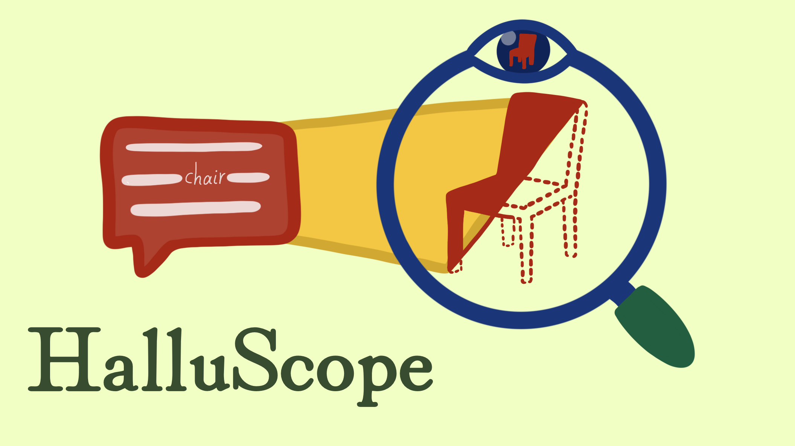
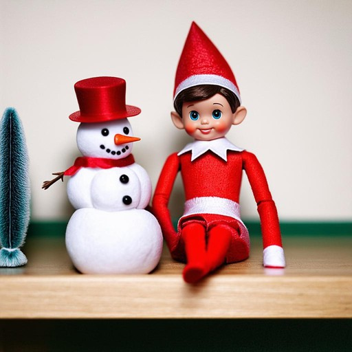

<p align="center">
  
</p>

# When Prompts Override Vision: Prompt-Induced Hallucinations in LVLMs

[](https://arxiv.org/abs/2604.21911)
[](https://pegah-kh.github.io/projects/prompts-override-vision/)


Pegah Khayatan, Jayneel Parekh, Arnaud Dapogny, Mustafa Shukor, Alasdair Newson, Matthieu Cord
(ISIR, Sorbonne Université · Valeo.ai)

This repository contains **HalluScope**, a benchmark that finds out *why* vision-language models (LVLMs) describe things that are not in the image, and **HalluVL-DPO**, a training dataset and method that reduces one of the main causes.

## In short

Vision-language models sometimes "see" objects that are not there. Existing benchmarks count these errors but do not say where they come from. There are three usual suspects:

1. **Perception:** the model does not see the image correctly.
2. **Co-occurrence habits:** the model expects objects that usually appear together (a fork next to a plate).
3. **The question itself:** the question assumes an object is there ("What color is the cat?"), and the model goes along with it.

**HalluScope** separates them by asking four kinds of questions about each COCO image:

| Question type | Example | Correct answer | What it tests |
|---|---|---|---|
| Positive recognition | "Is there a baseball bat in the image?" (it is there) | yes | perception |
| Random recognition | "Is there a statue in the image?" (absent, unrelated to the scene) | no | perception |
| Adversarial recognition | "Does the image contain a baseball cap?" (absent, but typical of the scene) | no | co-occurrence habits |
| Adversarial presupposition | "What logo appears on the baseball cap worn by the batter?" (the same absent cap) | say there is no cap | influence of the question |

The absent objects are chosen among objects that often appear with the image's objects, and their absence is double-checked with an object detector (Grounding DINO) and a vision-language model. The benchmark has two subsets of 3,000 images.

**What we found:** across five popular models (InternVL3.5, Molmo, Qwen2-VL, Qwen2.5-VL, LLaVA-1.5), perception is mostly fine: yes/no questions about present or random objects are answered correctly over 85% of the time. Accuracy drops on absent objects typical of the scene, and **drops much further when the question assumes the absent object is there**. The question is the strongest cause of hallucination, more than co-occurrence habits or the vision encoder.

**HalluVL-DPO** targets that cause. It is a set of about 20k answer pairs: for each image and question, a *grounded* answer and a *hallucinated* one, both written by the model being trained. Training the model to prefer the grounded answer (Direct Preference Optimization, DPO) makes it much better at rejecting false assumptions in questions, while its scores on general benchmarks stay close to the original model.

The images are synthetic (generated with Stable Diffusion 3 from filtered captions), so we know exactly which objects are in each one. Example pairs, one per type:

<table>
  <tr><th>Image</th><th>Pair type</th><th>Question</th><th>Preferred (grounded)</th><th>Rejected (hallucinated)</th></tr>
  <tr>
    <td></td>
    <td><b>Question about an absent object</b> (CPQ)</td>
    <td>What color is the spatula resting near the skillet?</td>
    <td>There is no spatula in the image.</td>
    <td>The spatula resting near the skillet is black.</td>
  </tr>
  <tr>
    <td></td>
    <td><b>Question about a present object</b> (TPQ)</td>
    <td>What color is the bird?</td>
    <td>It has a black head with a white stripe, a yellow body with orange and red accents, and a black beak.</td>
    <td>The bird is not shown in the image.</td>
  </tr>
  <tr>
    <td></td>
    <td><b>Yes/no, present object</b> (POPE)</td>
    <td>Do you see a elf on the shelf in the picture?</td>
    <td>Yes, there is an elf on the shelf in the picture. The elf is sitting next to a snowman.</td>
    <td>No, there is no elf on the shelf in the picture.</td>
  </tr>
  <tr>
    <td></td>
    <td><b>Yes/no, absent object</b> (POPE)</td>
    <td>Would you say there's a ladder visible?</td>
    <td>There is no ladder visible in the image.</td>
    <td>Yes, there is a ladder visible in the image. It is located on the side of the building.</td>
  </tr>
  <tr>
    <td></td>
    <td><b>Wrong attributes</b>: an LLM rewrites a correct answer with wrong details</td>
    <td>What is the condition of the road surface?</td>
    <td>The road surface appears to be wet, likely due to recent or ongoing rain.</td>
    <td>The road surface appears dry and dusty, with a matte finish and no visible reflections or puddles.</td>
  </tr>
  <tr>
    <td></td>
    <td><b>Description, one-sided hint</b>: a false hint is added to the question to get the hallucinated answer</td>
    <td>Could you offer a thorough description of the image?</td>
    <td>The image features a man playing a <b>trumpet</b> in a clean studio setting. …</td>
    <td>The image features a man playing a <b>trombone</b>, with the instrument held in his hands. …</td>
  </tr>
  <tr>
    <td></td>
    <td><b>Description, opposite hints</b>: a true hint for one answer, a false hint for the other</td>
    <td>Provide a detailed description of the image?</td>
    <td>The image features a dense forest with a large number of trees, including a couple of very tall trees. …</td>
    <td>The image features a lush green forest with a <b>trail</b> running through it. Along the trail, there is a <b>bench</b> … A <b>stream</b> can be seen nearby. …</td>
  </tr>
  <tr>
    <td></td>
    <td><b>Description, injected hallucination</b>: one sentence is replaced by a false one, and the model writes the rest</td>
    <td>Can you describe what you see in the image?</td>
    <td>The image depicts a view looking up through the canopy of tall trees … The sky is visible through the gaps in the leaves. …</td>
    <td>The image depicts a view looking up through the canopy of tall trees … The scene includes a <b>campfire</b>, which is positioned in the lower left corner of the image. …</td>
  </tr>
</table>

Only pairs whose two answers are clearly different are kept. The paper also proposes a weighted variant, HalluVL-DPO<sup>w</sup>, where an LLM rates how different each pair is (1 to 3) and that rating weights the pair during training.

## Repository

| Folder | Content |
|---|---|
| [`halluscope/`](halluscope/README.md) | The HalluScope benchmark ([`benchmark/`](halluscope/benchmark/README.md): v1 used in the paper, v2 regenerated with this code), the code that builds it, and the code to evaluate a model on it |
| [`halluvl/dpo/`](halluvl/dpo/README.md) | The HalluVL-DPO preference dataset and the pipeline that built it |

## Citation

```bibtex
@inproceedings{khayatan2026prompts,
  title     = {When Prompts Override Vision: Prompt-Induced Hallucinations in {LVLMs}},
  author    = {Khayatan, Pegah and Parekh, Jayneel and Dapogny, Arnaud and Shukor, Mustafa and Newson, Alasdair and Cord, Matthieu},
  booktitle = {Advances in Neural Information Processing Systems},
  year      = {2026}
}
```
